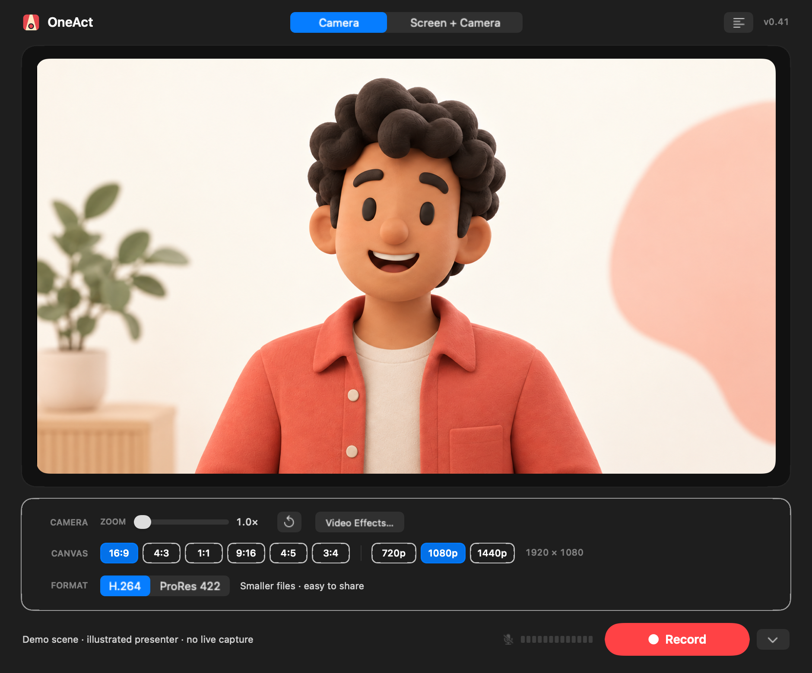
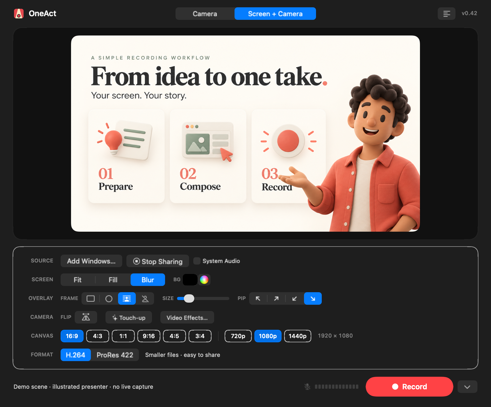
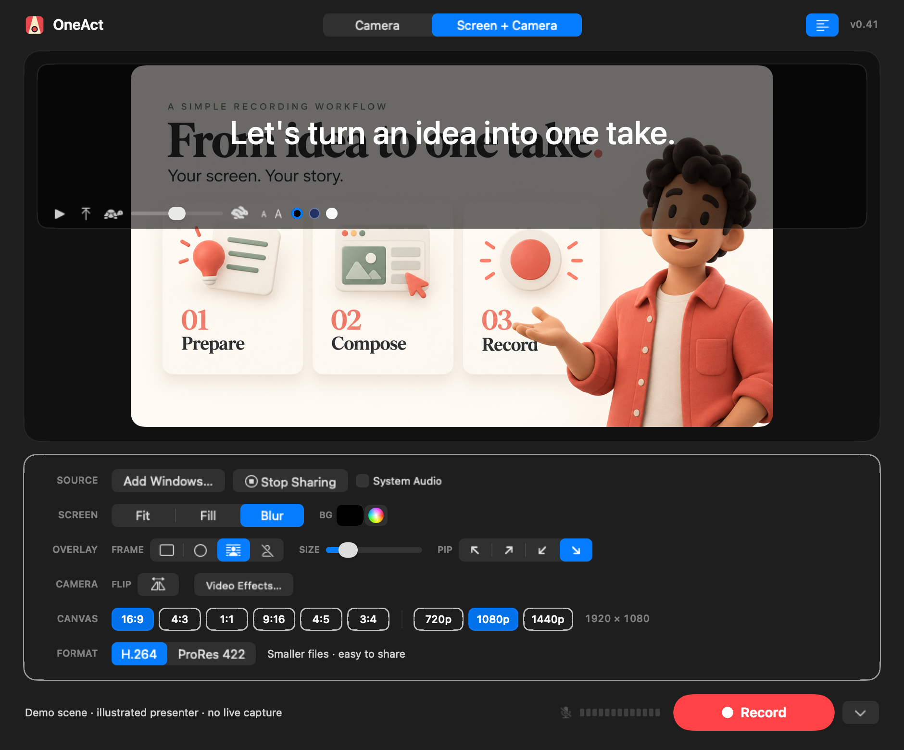

# OneAct

**One stage. One take.**

OneAct is an open-source, native Mac recorder. Compose your video as you record: **what you see is what you save.**

[Website](https://quentinzhang.github.io/oneact/) · [Download](https://github.com/quentinzhang/oneact/releases/latest) · [Report an issue](https://github.com/quentinzhang/oneact/issues) · [简体中文](README.zh-CN.md)



*The canvas shows an illustrative demo scene. The presenter is a fictional illustration, with no real-person footage.*

### Three ways to record

| Camera | Screen + Camera | With Teleprompter |
| --- | --- | --- |
| [](website/assets/demo-camera.png) | [](website/assets/hero-demo.png) | [](website/assets/demo-teleprompter.png) |
| A personal message, a lesson, a thought worth sharing. | Bring your screen into the story when a demonstration helps. | Keep your next thought close, outside the recorded video. |

[Switch between the three previews on the website](https://quentinzhang.github.io/oneact/#demo). The teleprompter works with either Camera or Screen + Camera.

## Features

- **What you see is what you save** — Your canvas is composed live. Framing, backgrounds, and camera placement are already part of the saved video.
- **Pause and resume** — Take a moment, reframe, and continue in the same recording. Paused time stays out of the video.
- **Keep your words close** — A built-in teleprompter holds your script above the canvas, with English and Chinese pacing and a countdown to settle in. Your script stays out of the video.
- **Share your screen when the story calls for it** — Bring a display, app, or window into a lesson, walkthrough, or product demo, with an optional camera overlay.
- **Make the shot yours** — Landscape, portrait, and square canvases; Fit, Fill, and Blur layouts; draggable picture-in-picture; person cutout, custom colors, and software zoom.
- **Your voice, in the mix** — Choose a microphone, add system audio, or record computer audio on its own.
- **A file ready for what comes next** — Save MOV files with AAC audio. Choose H.264 for everyday sharing or ProRes 422 for further editing.
- **Made on your Mac** — No account required. Recording, scripts, and person segmentation stay on your Mac. Version checks connect to GitHub.

## Download and install

Requires an **Apple Silicon Mac running macOS 15 or later**. OneAct is currently in beta. Intel Macs have not been validated.

1. Download `OneAct-macOS-arm64.zip` from [GitHub Releases](https://github.com/quentinzhang/oneact/releases/latest).
2. Unzip it, drag `OneAct.app` to Applications, and open it.
3. Follow the prompts to allow camera, microphone, and screen recording access.

Each release includes `SHA256SUMS`. To verify your download, run this in the download folder:

```bash
shasum -a 256 -c SHA256SUMS
```

Use **OneAct → Check for Updates…** to check the GitHub Pages version feed and open the matching GitHub Release download. Replace the app manually to update. Versions up to 0.39 use the old update feed; download v0.40 or later manually to migrate.

## Build from source

You need macOS 15+ and Xcode or Command Line Tools with Swift 6 support. There are no third-party Swift dependencies.

```bash
git clone https://github.com/quentinzhang/oneact.git
cd oneact
./scripts/package-app.sh
open build/OneAct.app
```

Local builds use ad-hoc signing by default, so no developer certificate is required. Developer ID signing and Apple notarization are covered in the [release guide](docs/RELEASING.md) (Chinese).

To run the recording pipeline checks without a camera:

```bash
BIN_PATH="$(swift build -c release --show-bin-path)"
"$BIN_PATH/OneAct" --self-test /tmp/oneact-h264.mov
"$BIN_PATH/OneAct" --self-test /tmp/oneact-prores.mov --prores
```

These checks cover compositing, audio/video writing, pause and resume, and color round trips. Real devices and permission flows still need manual testing. See the [development notes](docs/DEVELOPMENT.md) (Chinese) for additional diagnostics and implementation details.

## Current limitations

- OneAct is early-stage software. Make a short test recording and check its audio and picture before an important session.
- Camera-only output is limited by the actual input resolution, crop, and zoom. Enlarging the output cannot create new source detail.
- ProRes uses 10-bit 4:2:2 encoding, but the current compositing buffer is 8-bit BGRA. HDR and RAW recording are not supported.
- The teleprompter window is marked as non-shareable. Verify its behavior with your macOS version and any third-party screen-sharing software.

## Contributing

Bug reports and focused pull requests are welcome. Please read the [contributing guide](CONTRIBUTING.md).

The website screenshot is reproducible without live camera or screen capture. See the [demo asset notes](Design/README.md).

## License

Copyright © 2026 OneAct contributors.

OneAct is licensed under the **GNU General Public License v3.0 only** (`GPL-3.0-only`). See [LICENSE](LICENSE) for the full terms. If you distribute modified versions, you must comply with the license, including its corresponding-source requirements. This software is provided without warranty.
